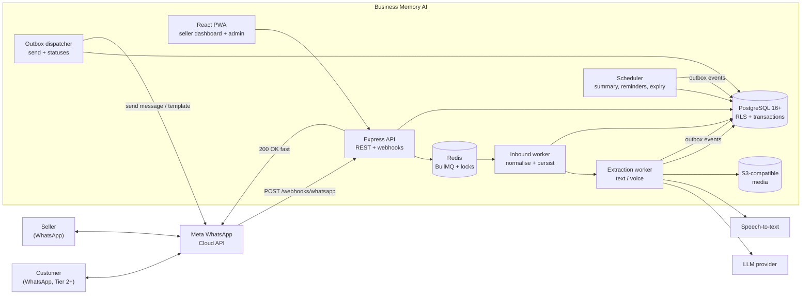
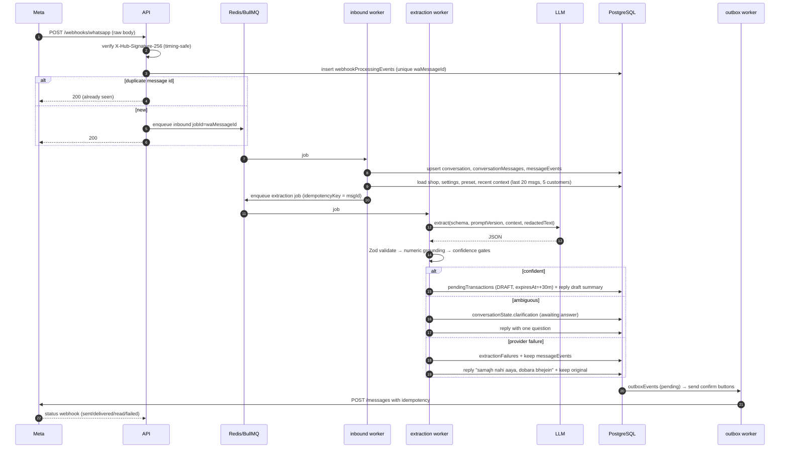

# 01 — Architecture (Tier 1)

> **Storage note (2026-11-13):** the persistence layer is PostgreSQL 16+, not MongoDB. The
> authoritative schema, roles and RLS design are in [13-rls-and-roles.md](13-rls-and-roles.md);
> the security model is in [11-threat-model.md](11-threat-model.md). MongoDB references below are
> historical and are being replaced by PostgreSQL equivalents during the Phase 1 rewrite.

## 1. System context



All external vendors sit behind interfaces (`MessagingProvider`, `LlmProvider`, `SttProvider`,
`OcrProvider`, `StorageProvider`, `PaymentGateway`). Provider selection is configuration, not
code. Tier 1 implements: `SimulatorMessagingProvider`, `OpenAiLlmProvider`,
`OpenAiWhisperSttProvider`, `LocalDiskStorageProvider` (S3 driver present but unused until
credentials exist).

## 2. Runtime layout

| Process | Responsibility | Scales on |
|---|---|---|
| `api` | REST for dashboard/admin, webhook ingest, simulator endpoints. No heavy work. | request rate |
| `worker:inbound` | Normalise webhook payloads, dedupe, dispatch by message type | queue depth |
| `worker:extraction` | Transcription, LLM extraction, validation, draft creation | queue depth |
| `worker:outbox` | Send WhatsApp messages/templates, record statuses, retry | message rate |
| `worker:scheduler` | Cron-style jobs with distributed locks: 20:00 summary, reminder due checks, draft expiry, promise due checks | instance count |
| `web` | Vite build served statically | CDN |

**Why one API process and not microservices:** 10–20 shops is a few hundred messages a day.
Splitting services now buys nothing and costs a distributed tracing problem. The module
boundaries are enforced in code and the queue boundary already exists, so extraction or billing
can be split out later without changing callers.

**Why queues even at this scale:** webhook acknowledgement must be < 2 s and Meta retries on
timeout. A synchronous LLM call inside the webhook is the single most common way this product
fails. Async is not premature here.

## 3. Primary flow — a text entry



Seller then taps **Confirm**. The confirm handler re-reads the draft, re-validates the balance
impact inside a transaction, posts immutable `ledgerEntries`, marks the draft `CONFIRMED`, writes
an `auditLogs` row, and enqueues the confirmation reply - all in one PostgreSQL transaction with the
outbox write.

**Double-tap safety:** the draft carries `version`; confirm requires `{ draftId, version }` plus a
per-shop unique `idempotencyKey` derived from `(waMessageId, buttonId)`. Second tap returns the
first result, never a second entry.

## 4. Ledger model (the part that must be right)

Double-entry-lite, single-writer:

- `ledgerEntries` rows are **immutable** and append-only.
- Each posting group shares a `postingId` (UUID) so a debit/credit pair or a multi-line bill is
  one atomic unit.
- Customer balance is **derived** (`sum(debit) - sum(credit)` over that customer) and cached in
  `customers.cachedOutstandingPaise`, refreshed inside the same transaction. The cached value is
  a read optimisation with a nightly reconciliation job that asserts cache == ledger sum.
- Corrections create a `REVERSAL` entry pointing at `reversesEntryId`, then optionally a corrected
  entry. Nothing is ever `$set` on a posted row.
- `periodLocks` blocks new postings dated inside a locked month; only `ADJUSTMENT` with a reason
  is allowed, and it is flagged for the owner.

Direction convention (single table, signed by `direction`):

| category | customer effect | cash effect |
|---|---|---|
| SALE | increases receivable (debit) | — |
| PAYMENT_RECEIVED | reduces receivable (credit) | increases cash/bank (debit) |
| EXPENSE | — | decreases cash (credit) |
| PURCHASE | increases payable (credit) | — |
| REFUND | reduces cash | — |
| SALES_RETURN | reduces receivable | — |
| OPENING_BALANCE | sets starting receivable | — |
| ADJUSTMENT | seller-directed | seller-directed |

## 5. Provider interfaces

```ts
// backend/src/integrations/messaging/types.ts (shape, not final code)
interface MessagingProvider {
  sendText(input: SendTextInput): Promise<SendResult>;
  sendButtons(input: SendButtonsInput): Promise<SendResult>;
  sendList(input: SendListInput): Promise<SendResult>;
  sendTemplate(input: SendTemplateInput): Promise<SendResult>;
  sendMedia(input: SendMediaInput): Promise<SendResult>;
  downloadMedia(mediaId: string): Promise<DownloadedMedia>;
  markRead(messageId: string): Promise<void>;
}
```

`SimulatorMessagingProvider` writes to a local `simulator_messages` table and serves a tiny
HTML/JSON inbox, so the entire product is demoable with zero Meta credentials. Swapping to
`MetaCloudMessagingProvider` is one env var (`MESSAGING_PROVIDER=meta`).

Trade-off: the simulator cannot reproduce Meta's template approval, quality rating or billing
behaviour. Those paths are unit-tested against recorded payload fixtures and verified in staging
with a Meta test number.

## 6. AI pipeline and guardrails

```
raw input ──► normalise (script, digits, number-words) ──► context pack ──► LLM (JSON schema)
   │                                                              │
   │                                                              ▼
   │                                             Zod validate ──► grounding check
   │                                                              │
   └─ always persisted unchanged                                  ▼
                                                     confidence ─┬─ high → draft
                                                                 ├─ mid  → one clarifying question
                                                                 └─ low  → 3 likely options, never dead end
```

- **Prompt injection:** customer/forwarded/OCR text is delivered to the LLM inside a delimited
  `<<<UNTRUSTED_INPUT>>>` block with an explicit system rule that it is data. The LLM cannot
  call tools, cannot write to the DB, and its output must satisfy a closed Zod schema. Any
  instruction-like content is irrelevant because the only effect of a successful extraction is a
  *draft awaiting human confirmation*.
- **Numeric grounding:** every amount/quantity in the extraction must be reproducible from the
  source string (after number-word normalisation) or from an explicitly matched context entity
  (e.g. a standing order rate). Failure → clarification, not a guess.
- **Cost control:** intent classifier (cheap model, ~200 tokens) routes simple intents; the
  strong model is used only when the cheap pass returns low confidence. Every call logs model,
  tokens, latency, `promptVersion` into `costLogs`.
- **Prompt versions** are files with a content hash; the hash is stored on every extraction run so
  accuracy can be attributed. Changing a prompt requires a new version, never an in-place edit.

## 7. Feature flags and plans

Evaluation order (first match wins), all evaluated server-side:

1. `FEATURE_KILL_SWITCH` (env) — global.
2. `shopSettings.featureOverrides[flag]` — per-shop boolean.
3. `plans.entitlements[flag]` — per-plan.
4. default `false`.

Every module route and every WhatsApp command handler is wrapped by `requireFeature(flag)`.
Flags used in Tier 1: `ledger`, `voice`, `photo`, `promises`, `reminders`, `dailySummary`,
`exports`, `dashboard`, `autoConfirmSmallAmounts`, `reconciliationOcr` (off).

## 8. Trade-offs I am making deliberately

| Decision | Alternative | Why |
|---|---|---|
| PostgreSQL transactions + outbox | direct send inside request | crash-safe; never "entry saved but seller got no reply" |
| Immutable ledger + derived balance | mutable balance field | auditability, undo, disputes |
| Server-side feature flags only | client flags | a dark module must be unreachable, not hidden |
| Draft-first for every transaction | direct posting | rule 5/6: nothing financial happens unreviewed |
| One repo, npm workspaces | separate repos | shared Zod contracts; 1 deploy for a 20-shop product |
| Prompt-as-versioned-file | prompts in DB | reviewable in git, hashable, testable in CI |
| WhatsApp number = identity | email/password | zero-install promise is the product |

## 9. What Tier 1 explicitly does not do

No bookings, no customer-facing ordering, no invoices/GST output, no payables, no inventory, no
gateway, no OCR matching, no multi-user beyond OWNER/HELPER, no campaigns. Model fields that hint
at them are nullable and unused, guarded by flags.
