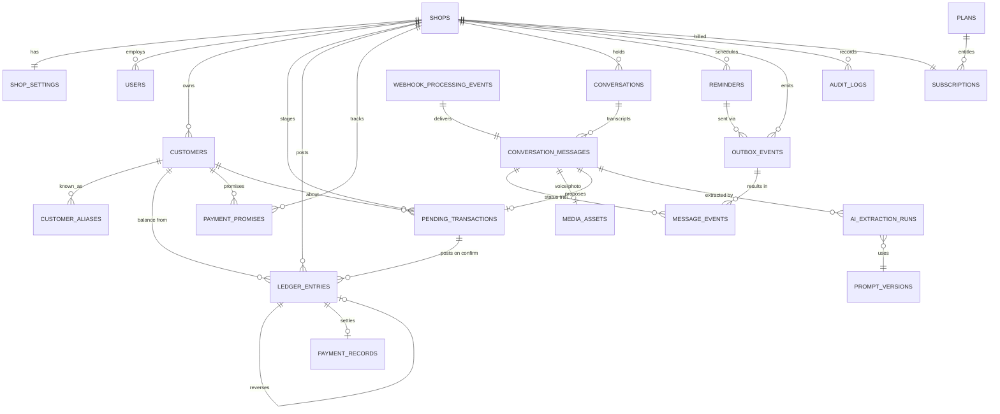

# 02 — Data model (Tier 1)

> **Storage mapping (2026-11-13):** this document describes the **domain** model. Physical storage
> is PostgreSQL 16+, not MongoDB. The authoritative DDL, roles, RLS policies and constraints are in
> [13-rls-and-roles.md](13-rls-and-roles.md).
>
> | Domain name below | PostgreSQL |
> |---|---|
> | collection | table in schema `app` |
> | `_id` (ObjectId) | `id uuid PRIMARY KEY DEFAULT gen_random_uuid()` |
> | `shopId` (ObjectId) | `shop_id uuid NOT NULL` + RLS |
> | `createdAt` / `updatedAt` | `created_at` / `updated_at timestamptz` |
> | Mongoose validator | `CHECK` constraint |
> | TTL index | `expires_at` + bounded cleanup job (PostgreSQL has no TTL) |
> | `tenantGuard` plugin | RLS + `withTenant()` scoped helpers |
> | `Decimal128`/`Double` money | `BIGINT` paise with `CHECK` |

Conventions applied to **every** shop-owned table:

| Field | PostgreSQL type | Rule |
|---|---|---|
| `id` | `uuid` | `DEFAULT gen_random_uuid()` |
| `shop_id` | `uuid` → `shops.id` | `NOT NULL` on every shop-owned table; never trusted from the client |
| `created_by` | `text` → `users.id` \| `SYSTEM` | who caused it |
| `created_at` / `updated_at` | `timestamptz` | `updated_at` via trigger |
| `version` | `integer` | optimistic concurrency, default 1 |
| `deleted_at` | `timestamptz` \| `NULL` | soft delete where financial history matters |

Money: `*_paise` suffix everywhere, `BIGINT` with `CHECK (>= 0)` and a per-entry ceiling
(except signed balance deltas, which are derived, not stored as money rows). **No `NUMERIC` money,
no `double precision`, no floats, no rupees at rest.**

Every shop-owned table gets a `shop_id`-prefixed index for its dominant query. Any access without
`SET LOCAL app.shop_id` returns zero rows and rejects inserts (RLS, fail-closed).

---

## 1. ERD (Tier 1)



---

## 2. Identity & tenancy

### `shops`
| field | type | notes |
|---|---|---|
| `name` | String(80) | required |
| `slug` | String | unique, for share links |
| `category` | enum | `HOME_SELLER, TIFFIN, DAIRY, BAKERY, BOUTIQUE, KIRANA, SALON, TUITION, TAILOR, REPAIR, OTHER` |
| `presetKey` | String | → `businessPresets.key` |
| `ownerUserId` | uuid → users.id | the owning user |
| seller phone | — | **not on `shops`**; identity lives in `users` as ciphertext + blind index (a shop may have staff numbers) |
| `language` | enum | `hi, mr, en, hinglish` |
| `timezone` | String | default `Asia/Kolkata` |
| `financialYearStartMonth` | Number | 4 |
| `status` | enum | `ONBOARDING, ACTIVE, SUSPENDED, CLOSED` |
| `onboardedAt` | Date | null while onboarding |
| `trialEndsAt` | Date | nullable |

Indexes: `{ slug: 1 }` unique, `{ status: 1, trialEndsAt: 1 }`.

### `shopSettings` (1:1 with shop)
`shopId` unique. Fields grouped: `features` (map of overrides), `money` (`gstEnabled`,
`gstin`, `taxRounding: PER_LINE|PER_INVOICE`), `reminders` (`quietHoursStart/End`,
`frequencyCapPerCustomerPerWeek`, `defaultReminderApproved: false`), `messaging`
(`identityType`, `wabaId?`, `phoneNumberId?`, `autoReplyEnabled`), `retention`
(`transcriptDays`, `mediaDays`, `keepAudio: false`), `confirmations`
(`autoConfirmSmallAmounts: false`, `autoConfirmLimitPaise: 0`), `summary` (`dailySummaryHour: 20`),
`locales` (`voiceReplies: false`, `easyReading: false`).

### `users`
Every seller-side user is shop-scoped (`shop_id NOT NULL`). Admin and support identities live in a
separate platform table (`admin_users`) and never in a shop's `users`.
`role` enum `OWNER|HELPER|DELIVERY|ACCOUNTANT`, `name`, `phone_enc` (AES-256-GCM),
`phone_bidx` (HMAC-SHA256, unique within the shop), `status` enum `INVITED|ACTIVE|DISABLED`,
`permissions` (sparse overrides), `last_login_at`, `device_count`, `session_epoch`.
Indexes: unique `{ shop_id, phone_bidx }`; `{ role, status }`; platform `login_index(phone_bidx)` for
cross-shop login lookup (read only through `app.resolve_login`).

### `refreshTokens`
`userId`, `shopId`, `tokenHash` (sha256), `familyId`, `rotatedFromId`, `userAgentHash`,
`ipHash`, `expiresAt`, `revokedAt`, `revokedReason`.
Indexes: `{ tokenHash: 1 }` unique; `{ userId: 1, revokedAt: 1 }`; `expires_at` (bounded cleanup
job, no TTL). Reuse of a rotated token revokes the whole family and writes a `security_events` row.

### `otpChallenges`
`phone_e164_enc` (ciphertext), `phone_bidx` (blind index), `purpose` (`LOGIN|PHONE_CHANGE|DELETE_ACCOUNT`), `code_hash` (HMAC-SHA256 with a server pepper), `attempts`,
`expires_at` (5 minutes), `consumed_at`, `request_ip_hash`.
Indexes: `phone_bidx + purpose + created_at`; `expires_at` (cleanup job, not a TTL index).
Codes are never stored or logged in plaintext.

### `plans`
`key` (`FREE|PRO|BUSINESS`), `name`, `pricePaise`, `currency: INR`, `interval`, `entitlements`
(map flag→bool/limit), `isDraft`, `sortOrder`. No price appears in application code.

### `subscriptions`
`shopId` unique, `planKey`, `status` (`TRIALING|ACTIVE|GRACE|CANCELLED|EXPIRED`), `trialEndsAt`,
`currentPeriodStart/End`, `provider`, `providerSubscriptionId`, `cancelAtPeriodEnd`,
`graceEndsAt`. Index `{ status: 1, currentPeriodEnd: 1 }`.

---

## 3. Customers

### `customers`
| field | type | notes |
|---|---|---|
| `name` | String(80) | display name |
| `normalizedName` | String | lowercase, honorifics stripped → search |
| `phone_enc` / `phone_bidx` | bytea \| null | ciphertext + blind index; null = ledger-only customer (no messages ever) |
| `address_enc` | bytea \| null | ciphertext (≤240 chars plaintext) |
| `language` | enum \| null | |
| `balancePaise` | Number | **derived cache**, signed: + means customer owes seller; rebuilt from the ledger, never the source of truth |
| `creditLimitPaise` | Number \| null | warn only |
| `optedOutAt` | Date \| null | STOP / "Band karo" |
| `tags` | [String] | preset-driven labels |
| `notes_enc` | bytea \| null | ciphertext (≤500 chars plaintext) |
| `mergedIntoId` | uuid \| null | merges keep history |
| `lastTransactionAt` | Date \| null | for lapsed-customer insight |

Indexes: `{ shopId: 1, phone_bidx: 1 }` unique partial (`phone_enc IS NOT NULL`);
`{ shopId: 1, normalizedName: 1 }`; `{ shopId: 1, balancePaise: -1 }`; `{ shopId: 1, lastTransactionAt: 1 }`.

Rules: duplicate detection runs on create (same phone, or name similarity ≥ 0.9 → ask seller);
merge requires OWNER and consolidates ledger by repointing `customerId`, never by copying entries;
an opted-out customer is excluded from every outbound query, enforced in the reminder service,
not the UI.

### `customerAliases`
`customerId`, `alias` (e.g. "Sharma ji", "Sharma wali aunty", "bhaiya"), `normalizedAlias`,
`learnedFrom` (`SELLER_CONFIRMED|MANUAL`), `confirmedByUserId`.
Indexes: `{ shopId: 1, normalizedAlias: 1 }` (non-unique: ambiguity is resolved by asking);
`{ shopId: 1, customerId: 1 }`. Aliases are **only** created after seller confirmation; an
unconfirmed guess stays in the extraction draft as `candidateCustomerId`.

### `payerAliases` (Tier 1: schema only, matching is Tier 2)
`customerId`, `payerName`, `upiHandle`, `confirmedByUserId`. Index `{ shopId: 1, upiHandle: 1 }`.

---

## 4. Financial core

### `pendingTransactions` (every entry starts here)
| field | type | notes |
|---|---|---|
| `source` | enum | `WHATSAPP_TEXT, WHATSAPP_VOICE, WHATSAPP_IMAGE, DASHBOARD, IMPORT, SYSTEM` |
| `sourceMessageId` | uuid \| null | → conversationMessages |
| `status` | enum | `DRAFT, AWAITING_CLARIFICATION, CONFIRMED, REJECTED, EXPIRED, FAILED` |
| `intent` | enum | `SALE, PAYMENT_RECEIVED, EXPENSE, PURCHASE, REFUND, SALES_RETURN, OPENING_BALANCE, ADJUSTMENT, PROMISE, QUERY, UNKNOWN` |
| `draft` | subdoc | see below |
| `candidateCustomerIds` | [uuid] | ambiguity, max 3 |
| `confidence` | Number 0–1 | per-field breakdown in `fieldConfidence` |
| `requiresClarification` | Boolean | |
| `clarificationQuestion` | String \| null | |
| `expiresAt` | Date | expiry + cleanup job, 30 min default |
| `confirmedAt` / `confirmedByUserId` | | |
| `postedLedgerEntryIds` | [uuid] | |
| `idempotencyKey` | String | unique per shop |
| `extractionRunId` | uuid | → aiExtractionRuns |
| `rawText` | String | never deleted even if extraction fails |
| `rejectionReason` | String \| null | |

`draft` subdocument: `customerId?`, `customerNameRaw?`, `amountPaise`, `paymentMethod`,
`category`, `occurredAt`, `note`, `items[]` (`name, qty, unit, unitPricePaise, lineTotalPaise`),
`discountPaise`, `deliveryChargePaise`, `taxPaise`, `direction`, `promiseDate?`.

Indexes: `{ shopId: 1, idempotencyKey: 1 }` unique; `{ shopId: 1, status: 1, createdAt: -1 }`;
`{ shopId: 1, sourceMessageId: 1 }` unique partial; `expires_at` **partial on `status = 'DRAFT'`**
plus a bounded cleanup job, so confirmed history is never removed. Expiry is also enforced in code
so we can send a polite "please resend" message before the cleanup job removes the row — the job is
a safety net, not the mechanism.

### `ledgerEntries` (immutable)
`postingId` (UUID), `entrySeq`, `customerId?`, `category`, `direction` (`DEBIT|CREDIT`),
`amountPaise`, `paymentMethod`, `occurredAt` (business date, IST-anchored), `postedAt`,
`description`, `note`, `sourceType`, `sourceId`, `pendingTransactionId?`, `reversesEntryId?`,
`reversedByEntryId?`, `periodLockId?`, `adjustmentReason?`, `runningBalancePaise?` (snapshot for
statements), `idempotencyKey`.
Indexes: `{ shopId: 1, idempotencyKey: 1 }` unique; `{ shopId: 1, occurredAt: -1 }`;
`{ shopId: 1, customerId: 1, occurredAt: -1 }`; `{ shopId: 1, postingId: 1 }`.
**No update or delete route exists.** Only `insertMany` inside a session.

### `paymentRecords`
`customerId`, `amountPaise` (applied), `method`, `reference` (`UPI ref`, `CASH`), `provider`,
`providerRef?`, `receivedAt`, `allocations[]` (`ledgerEntryId`, `amountPaise`), `source`
(`SELLER_CONFIRMED|CUSTOMER_REPORTED|IMPORT`), `confirmedByUserId`, `status`
(`UNMATCHED|MATCHED|PARTIALLY_MATCHED|VOID`).
Indexes: `{ shopId: 1, provider: 1, providerRef: 1 }` unique partial (providerRef exists) →
duplicate UPI reference is rejected at the DB, not just in code.

### `paymentPromises`
`customerId`, `amountPaise`, `promisedFor` (date), `status`
(`PENDING_APPROVAL|ACTIVE|FULFILLED|PARTIALLY_FULFILLED|MISSED|CANCELLED`),
`sourceMessageId`, `confirmedByUserId`, `fulfilledByPaymentId?`, `fulfilledPaise`,
`reminderCount`, `lastRemindedAt`, `closedAt`, `note`.
Indexes: `{ shopId: 1, status: 1, promisedFor: 1 }`; `{ shopId: 1, customerId: 1, status: 1 }`.
Invariant enforced in the service: creating a promise never touches `customers.balancePaise`.

### `periodLocks`
`shopId`, `year`, `month`, `lockedAt`, `lockedByUserId`, `note`. Unique `{shopId, year, month}`.
Posting service rejects a non-adjustment entry whose `occurredAt` falls in a locked month.

---

## 5. Messaging

### `conversations`
`shopId`, `contact_phone_enc` / `contact_phone_bidx` (ciphertext + blind index), `contactRole`
(`SELLER|HELPER|DELIVERY|CUSTOMER|UNKNOWN`),
`state` (`IDLE|ONBOARDING|AWAITING_CLARIFICATION|AWAITING_CONFIRMATION|AWAITING_APPROVAL`),
`stateData` (jsonb, schema-validated per state), `lastInboundAt`, `lastOutboundAt`,
`serviceWindowExpiresAt` (lastInboundAt + 24 h), `language`.
Indexes: `{ shopId: 1, contact_phone_bidx: 1 }` unique; `{ serviceWindowExpiresAt: 1 }`.

### `conversationMessages`
`conversationId`, `waMessageId` (unique), `direction` (`INBOUND|OUTBOUND`), `type`
(`TEXT|AUDIO|IMAGE|DOCUMENT|INTERACTIVE|TEMPLATE|SYSTEM`), `text`, `transcript`,
`transcriptLanguage`, `mediaId`, `mediaAssetId?`, `payload` (raw provider payload, redacted of
tokens), `providerTimestamp`, `status`, `replyToMessageId?`.
Indexes: `{ shopId: 1, createdAt: -1 }`; `{ waMessageId: 1 }` unique;
`{ conversationId: 1, createdAt: -1 }`; `payload_expires_at` (bounded retention job).

### `messageEvents`
Status trail from webhooks: `waMessageId`, `eventType`
(`ACCEPTED|SENT|DELIVERED|READ|FAILED`), `errorCode`, `errorTitle`, `occurredAt`, `rawRef`.
Unique `{ waMessageId: 1, eventType: 1, occurredAt: 1 }` → idempotent status handling.

### `webhookProcessingEvents`
`waMessageId` (unique), `receivedAt`, `signatureValid`, `bodyHash`, `payload`, `status`
(`RECEIVED|PROCESSING|PROCESSED|FAILED|IGNORED`), `jobId`, `error`, `attempts`.
30-day retention enforced by a bounded cleanup job (no TTL in PostgreSQL). This row is the
idempotency gate for Meta retries.

### `mediaAssets`
`kind` (`AUDIO|IMAGE|DOCUMENT`), `storageKey`, `mimeType`, `bytes`, `sha256`, `durationSec?`,
`width?/height?`, `linkedMessageId?`, `deletedAt`, `retentionDeleteAt`.
Index `retentionDeleteAt`; deletion is performed by a bounded retention job, not a TTL. Audio default
retention: deleted on successful transcription (immediate), row kept with `deletedAt` for audit.

### `whatsappTemplates` / `templateVersions`
`name`, `category` (`UTILITY|MARKETING|AUTHENTICATION`), `language`, `status`
(`DRAFT|SUBMITTED|APPROVED|REJECTED|PAUSED`), `rejectionReason`, `components`, `variables[]`,
`currentVersion`, `estimatedCostPaise`, `qualityRating`, `lastSyncedAt`.
`templateVersions`: `templateId`, `version`, `components`, `contentHash`, `approvedAt`,
`submittedAt`. Unique `{ shopId, name, language, version }`. Re-classification is a new version +
audit row, never an in-place mutation.

### `reminders`
`kind` (`PAYMENT_DUE|PROMISE_TODAY|PROMISE_MISSED|MONTHLY_BILL|BOOKING|CUSTOM_APPROVED`),
`customerId?`, `amountPaise?`, `dueAt`, `status`
(`DRAFT|AWAITING_APPROVAL|APPROVED|SENT|CANCELLED|FAILED|SKIPPED`),
`approvedByUserId?`, `approvedAt?`, `templateId?`, `dedupeKey`, `cancelReason?`, `sentAt`.
Indexes: `{ shopId: 1, status: 1, dueAt: 1 }`; unique `{ shopId: 1, dedupeKey: 1 }`.
Before send the worker re-checks: balance still > 0, no payment/self-report since approval, no
open dispute, customer not opted out, inside allowed hours. Any change → `CANCELLED` with reason
and a seller notification.

### `notificationLogs`
Seller-facing notifications (summary sent, job failed, quality drop…): `channel`
(`WHATSAPP|EMAIL|DASHBOARD`), `templateKey`, `payload`, `status`, `error`.

### `outboxEvents`
`topic` (`MESSAGE_SEND`, `REMINDER_SEND`, `SELLER_NOTIFY`), `aggregateType`, `aggregateId`,
`payload`, `status` (`PENDING|PROCESSING|SENT|FAILED|DEAD`), `attempts`, `nextAttemptAt`,
`dedupeKey`, `lockedBy`, `lockedUntil`, `lastError`.
Indexes: unique `{ shopId: 1, dedupeKey: 1 }`; `{ status: 1, nextAttemptAt: 1 }`.
Written **inside** the same transaction as the domain change. A dispatcher claims a batch with:

```sql
UPDATE app.outbox_events
   SET status = 'PROCESSING', locked_by = $1, locked_until = now() + interval '60 seconds'
 WHERE id IN (
   SELECT id FROM app.outbox_events
    WHERE shop_id = $2 AND status = 'PENDING' AND next_attempt_at <= now()
    ORDER BY next_attempt_at
    FOR UPDATE SKIP LOCKED
    LIMIT $3
 )
RETURNING *;
```

Safe across instances without a separate lock; a crashed worker's `locked_until` expires and the
row becomes claimable again.

---

## 6. AI / cost

### `aiExtractionRuns`
`messageId`, `provider`, `model`, `promptVersionId`, `promptHash`, `inputTokens`, `outputTokens`,
`latencyMs`, `costPaise` (estimated), `rawResponse` (redacted), `schemaValid`, `groundingPassed`,
`confidence`, `outcome` (`DRAFT|CLARIFY|FAILED|UNKNOWN`), `errorCode`.
Indexes: `{ shopId: 1, createdAt: -1 }`; `{ promptVersionId: 1, groundingPassed: 1 }` for accuracy
reporting.

### `promptVersions` (seeded from repo files, read-only at runtime)
`promptKey`, `version`, `contentHash`, `modelHint`, `createdAt`, `notes`, `evalScore`.
Unique `{ promptKey: 1, version: 1 }`.

### `costLogs`
`category` (`LLM|STT|VISION|WHATSAPP_TEMPLATE|WHATSAPP_FREE_FORM|STORAGE`), `provider`, `units`,
`unitType`, `rateVersionId`, `estimatedCostPaise`, `relatedId`.
Index `{ shopId: 1, category: 1, createdAt: -1 }`. Rates come from a `rate_tables` table
(config, versioned) so a Meta price change is data, not a deploy.

---

## 7. Trust, audit, compliance

### `auditLogs` (append-only, no shop-scoped delete)
`actorType` (`USER|SYSTEM|ADMIN`), `actorId`, `action` (e.g. `ledger.post`, `ledger.reverse`,
`customer.merge`, `role.change`, `export.create`, `settings.update`, `otp.fail`),
`entityType`, `entityId`, `before`, `after`, `ipHash`, `userAgentHash`, `requestId`,
`sensitiveView: Boolean`.
Indexes: `{ shopId: 1, createdAt: -1 }`; `{ entityType: 1, entityId: 1, createdAt: -1 }`;
`{ actorId: 1, createdAt: -1 }`. Never contains raw phone numbers, amounts are fine.

### `consentRecords`
`subjectType` (`SELLER|CUSTOMER`), `subjectId`/`phoneE164Hash`, `purpose`
(`BOOKKEEPING|REMINDERS|MARKETING|VOICE_PROCESSING|DATA_EXPORT`), `granted`, `method`
(`WHATSAPP_REPLY|DASHBOARD_TOGGLE`), `evidenceMessageId`, `policyVersion`, `grantedAt`,
`revokedAt`. Unique `{shopId, subjectType, subjectId, purpose, grantedAt}`.

### `optInEvidence` (Tier 1 skeleton, used by reminders)
`phoneE164Hash`, `customerId`, `purpose`, `evidence` (`message id`, timestamp, wording hash`),
`capturedAt`. Marketing reuse requires a separate, explicit opt-in record.

### `exportJobs`
`type` (`LEDGER_CSV|LEDGER_XLSX|FULL_BACKUP_JSON`), `status`, `requestedByUserId`, `fileKey`,
`expiresAt`, `rowCount`, `error`. Download links are signed and expire in 24 h; every create and
download is audited.

### `importJobs` (Tier 1: customers + opening balances only)
`type`, `status` (`UPLOADED|MAPPED|DRY_RUN|COMMITTED|FAILED|ROLLED_BACK`), `fileName`,
`mapping`, `dryRunSummary` (`validRows`, `errors[]`), `committedAt`, `rowCount`.
No partial writes: commit is one transaction or nothing.

### `idempotencyKeys`
`scope` (`CONFIRM_DRAFT|EXPORT|SEND_REMINDER`), `key`, `requestHash`, `responseSnapshot`,
`expiresAt`. Unique `{shop_id, scope, key}`; expired rows are deleted by a bounded cleanup job.

---

## 8. Isolation enforcement (non-negotiable)

1. `TenantContext` is created only by auth middleware from the verified JWT
   (`shopId`, `userId`, `role`) — never from body/query/header.
2. Every shop-owned table has `shop_id NOT NULL`, `ENABLE ROW LEVEL SECURITY`, `FORCE ROW LEVEL
   SECURITY`, and a `USING`/`WITH CHECK` policy on `shop_id = app.current_shop_id()`.
3. `withTenant(ctx, fn)` opens a transaction, sets `app.shop_id` with `set_config(..., true)`, and
   exposes only scoped helpers. A request without context sees zero rows and cannot insert.
4. Repositories expose `findById(ctx, id)` which always adds `shop_id` — no unscoped query helper.
   Cross-row references use composite `(shop_id, other_id)` foreign keys.
5. Cross-tenant reads are impossible by construction; `docs/12-security-test-plan.md` (`DB-07`…
   `DB-24`) asserts cross-shop read/write attempts, fail-closed behaviour, joins, aggregates and
   RLS bypass attempts.
6. `ADMIN` cross-shop access goes through a separate time-boxed ticket that still sets one
   `shop_id`; it never disables RLS and writes an `audit_logs` row with `sensitive_view: true`.

The full policy templates, role matrix and DDL are in [13-rls-and-roles.md](13-rls-and-roles.md).

---

## 9. Indexes summary (what Phase 1 will create + assert)

> Indicative only. PostgreSQL index DDL is in [13-rls-and-roles.md](13-rls-and-roles.md). TTL
> entries below become `expires_at` indexes plus bounded cleanup jobs.

Verified by a catalog test that reads `pg_indexes` and `pg_constraint` and diffs against a
snapshot, so an accidental index change fails CI:

- `shops`: `slug` (u), `status+trial_ends_at`
- `users`: `shop_id+phone_bidx` (u), `role+status`
- `login_index`: `phone_bidx` (u) — platform table, function-access only
- `refresh_tokens`: `token_hash` (u), `expires_at` (cleanup job)
- `customers`: `shop_id+phone_bidx` (u, partial), `shop_id+normalized_name`, `shop_id+balance_paise`,
  `shop_id+last_transaction_at`
- `ledger_entries`: `shop_id+idempotency_key` (u), `shop_id+occurred_at`, `shop_id+customer_id+occurred_at`,
  `shop_id+posting_id+entry_seq` (u)
- `pending_transactions`: `shop_id+idempotency_key` (u), `shop_id+status+created_at`,
  `shop_id+source_message_id` (u, partial), `expires_at` (partial on DRAFT, cleanup job)
- `payment_records`: `shop_id+provider+provider_ref` (u, partial)
- `payment_promises`: `shop_id+status+promised_for`, `shop_id+customer_id+status`
- `conversations`: `shop_id+contact_phone_bidx` (u), `service_window_expires_at`
- `conversation_messages`: `shop_id+wa_message_id` (u), `shop_id+created_at`, `conversation_id+created_at`
- `webhook_processing_events`: `shop_id+wa_message_id` (u), `received_at` (30 d cleanup job)
- `message_events`: `wa_message_id+event_type+occurred_at` (u)
- `outbox_events`: `shop_id+dedupe_key` (u), `status+next_attempt_at`
- `reminders`: `shop_id+status+due_at`, `shop_id+dedupe_key` (u)
- `audit_logs`: `shop_id+created_at`, `shop_id+entity_type+entity_id+created_at`
- `otp_challenges`: `phone_bidx+purpose+created_at`, `expires_at` (cleanup job)
- `idempotency_keys`: `shop_id+scope+key` (u), `expires_at` (cleanup job)
